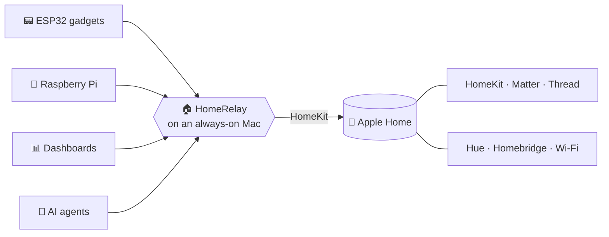

<div align="center">

# 🏠 HomeRelay

**Your Apple Home, as a local API anything can talk to.**

An ESP32 on your desk, a Raspberry Pi, a dashboard, a shell script: none of them can speak HomeKit.<br/>
HomeRelay runs on an always-on Mac and lets them read and control every light, lock, sensor and scene in your Home app.

[](LICENSE)


[What you can do](#-what-you-can-do) · [Devices](#-every-device-in-your-home-app) · [How it works](#-how-it-works) · [Setup](#-setup) · [API reference](docs/API.md)

</div>

---

<p align="center">
  
  <br/>
  <sub>The <a href="https://github.com/shhish/orb">Orb</a>, a round ESP32 screen, showing rooms and scenes it gets from HomeRelay.</sub>
</p>

## 💡 What you can do

| Ask HomeRelay… | …with one request |
| --- | --- |
| 🛋️ What's on in the living room? | `GET /accessories?room=Living Room` |
| 💡 Floor lamp on, 40% | `POST /accessories/Floor Lamp` `{"on": true, "brightness": 40}` |
| 🌙 Run "Good Night" | `POST /scenes/Good Night/run` |
| 🔒 Is the front door locked? | `GET /accessories/Front Door` → `"lockState": 1` |
| 🌡️ Set the thermostat to 21 °C | `POST /accessories/Thermostat` `{"targetTemperature": 21}` |
| 🔔 Tell me the moment anything changes | `GET /events` (a live stream) |
| ⏪ What happened while I was offline? | `GET /events?since=4182` (replays the last 14 days) |

Use the names from the Home app (URL-encoded, and `Bedroom/Lamp` if two rooms both have one), or ids that never change.

## 🏡 Every device in your Home app

If it shows up in the Home app, HomeRelay can see it, whether it's native HomeKit, **Matter**, **Thread**, Wi-Fi, a **Hue** bridge or something brought in through **Homebridge**.

| Kind | What you can read and change |
| --- | --- |
| 💡 Lights | on/off, brightness, colour, colour temperature |
| 🔌 Outlets & switches | on/off, in-use, stateless buttons |
| 🌡️ Climate | thermostats, heaters and AC, fans, air purifiers, humidifiers |
| 🔒 Security | locks, garage doors, security systems, doorbells |
| 🪟 Doors & blinds | doors, windows, window coverings, valves |
| 📡 Sensors | motion, occupancy, contact, temperature, humidity, light, leak, smoke, air quality, battery |
| 📺 Entertainment | TVs and speakers |
| 🎬 Scenes | everything you've set up in the Home app |

Values are made to fit: `"on"`, `1` and `true` all work, and a brightness of 150 becomes 100. Turning a light on happens before changing its brightness, and turning it off happens last, so lights don't flicker back on.

## 🧩 How it works



Every client talks plain HTTP with its own token: REST to read and change things, and a live event stream to hear about changes.

Only Apple devices can control an Apple Home, and HomeKit accessories can't be shared with anything else. So a Mac that stays on, signed in to your Home, does it on everyone else's behalf.

## ✨ What you get

- **Live events.** A Server-Sent Events stream pushes every change: a light turned on, a door opened, a sensor tripped, a device going offline.
- **Resumable.** Events are kept on disk for 14 days. Reconnect with the last number you saw and get what you missed, without duplicates.
- **Who did what.** Every change says whether the device reported it, a scene ran it, or a client wrote it, and which token did.
- **A token per device.** `control` or `read-only`, stored only as hashes. A dashboard can look but not touch.
- **Bonjour discovery.** Advertised over Bonjour as `_homerelay._tcp`, so gadgets don't need a hard-coded IP.
- **Easy on batteries.** Battery sensors are only woken when needed, and one dead device can't stall every request.
- **Compact responses.** `?compact=1` returns only the state, which suits a microcontroller.

> [!WARNING]
> HomeRelay is meant for your home network. Don't expose it to the internet.

## 🚀 Setup

**You need:** a Mac on macOS 26+ that stays on and is signed in to the iCloud account that owns the Home, plus Xcode 26+, [XcodeGen](https://github.com/yonaskolb/XcodeGen) and a paid Apple Developer account (HomeKit needs the HomeKit capability on your App ID).

```bash
cp Config/Local.xcconfig.example Config/Local.xcconfig   # your bundle prefix and team ID
scripts/install.sh                      # build, install to ~/Applications, start at login
scripts/homerelay-token add orb         # prints a control token once
scripts/homerelay-token add dash --read-only
scripts/smoke.py                        # checks the read paths
```

The first time it starts, macOS asks whether HomeRelay may use your Home data. Allow it; if you didn't, change it in System Settings → Privacy & Security → Home.

```bash
curl -H "Authorization: Bearer $TOKEN" http://my-mac.local:18796/api/v1/scenes
```

The whole API, with examples, is in [docs/API.md](docs/API.md).

<details>
<summary><b>⚙️ Running it, settings and layout</b></summary>

<br/>

**Keeping it running.** A LaunchAgent (`<bundle id>.backend`) runs `scripts/run.sh`, which starts the app through LaunchServices (HomeKit needs a real app launch) and relaunches it within about 5 seconds if it exits. The wrapper does the restarting because launchd delays its own restarts when the Mac is busy.

- Stop: `launchctl bootout gui/$(id -u)/<bundle id>.backend`
- Start again: `scripts/install.sh --no-build`
- Test a write: `scripts/smoke.py --write "Floor Lamp"` toggles it twice and checks the event.

**Settings** (LaunchAgent environment):

| Variable | Default | What |
| --- | --- | --- |
| `HOMERELAY_PORT` | `18796` | Port |
| `HOMERELAY_HOST` | `::` | Listen address (IPv6 and IPv4) |
| `HOMERELAY_POLL_SECONDS` | `30` | Re-read values that don't send change notifications; `0` turns it off |
| `HOMERELAY_LOG_READS` | off | `1` also logs successful GETs |
| `HOMERELAY_TOKENS_FILE` | Application Support | Token hashes, reloaded on change |
| `HOMERELAY_EVENT_LOG` | `…/HomeRelay/hot.sqlite` | Event log path; `off` disables it and stream resume |
| `HOMERELAY_SAMPLE_MINUTES` | `60` | How often an unchanged value is still logged |

**Layout**

| Path | What |
| --- | --- |
| `Packages/HomeRelayCore` | HTTP server (SwiftNIO), router, auth, values, events. No HomeKit, so `swift test` runs it against a fake home. |
| `Sources/HomeRelay` | The Mac Catalyst app: HomeKit, naming, config, Bonjour. |
| `scripts/` | Build, install, LaunchAgent wrapper, token tool, smoke test. |

**Tests**

```bash
cd Packages/HomeRelayCore && swift test
```
</details>

## 🤝 Related projects

- **[Orb](https://github.com/shhish/orb)**: a round ESP32 display that shows your rooms and runs scenes through HomeRelay.
- **[Switchboard](https://github.com/shhish/switchboard)**: gives AI agents (Claude, Codex, ChatGPT) Apple Home tools through HomeRelay, with approvals for locks and garage doors.

Issues and pull requests are welcome. The repo is mirrored from a private Gitea, so merged PRs come back with the next sync. MIT licensed, see [LICENSE](LICENSE).
